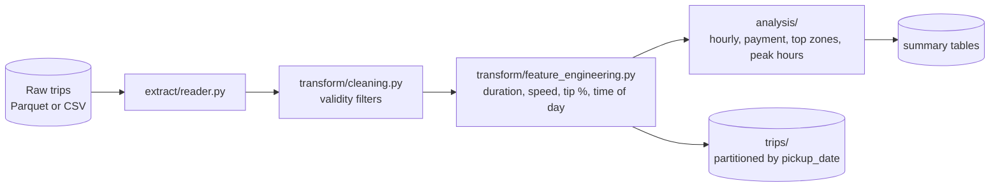

# NYC Yellow Taxi Spark ETL

[](https://github.com/ArturLy263/nyc-taxi-spark-etl/actions/workflows/ci.yml)

A modular PySpark batch pipeline for one month of NYC Yellow Taxi trip records: it filters invalid
trips, adds trip features, computes revenue and demand summaries, and writes the results as Parquet.
It runs locally with `local[*]`; it has not been deployed to a cluster.

## Pipeline



**Cleaning rules:** trip distance > 0; 0 < fare < 500; 1–6 passengers; non-null timestamps;
drop-off after pick-up; duration of at most 180 minutes.

**Analytics:**

- trips, average fare, tip % and duration per pick-up hour
- tip statistics per payment type, including the median (`percentile_approx`)
- top 10 pick-up zones by fare revenue
- busiest hour of each day, using a `dense_rank` window

## Output

`python -m src.main` writes Parquet to the output directory (`data/processed` by default):

```text
data/processed/
├── trips/                    # cleaned and enriched trips, partitioned by pickup_date
│   ├── pickup_date=2019-01-01/
│   └── ...
├── hourly_summary/
├── payment_summary/
├── top_revenue_locations/
└── peak_hours/
```

## Project structure

```text
src/
├── main.py                       # runs the pipeline; --input / --output arguments
├── extract/reader.py             # Parquet (TLC's format) or CSV
├── transform/cleaning.py
├── transform/feature_engineering.py
├── analysis/revenue_analysis.py
├── analysis/peak_hours.py
├── load/writer.py                # Parquet writer with optional partitioning
└── utils/spark_session.py
tests/                            # pytest tests on small in-memory DataFrames
```

## Run it

Requirements: Python 3.12 or 3.14, and Java 17 or later. Commands run from the repository root.

```bash
python3 -m venv .venv
source .venv/bin/activate
pip install -r requirements-dev.txt     # requirements.txt alone is enough to run the pipeline

python -m pytest tests -q

# try the pipeline on 18 synthetic trips, no download needed
python -m src.main --input examples/sample_trips.csv --output output
```

[`examples/sample_trips.csv`](examples/sample_trips.csv) is hand-written, not TLC data: 18 trips in
the TLC column layout, 6 of them invalid on purpose, so `output/trips` gets 12 rows in two
`pickup_date` folders.

To process real data, download **Yellow Taxi Trip Records, January 2019** (`yellow_tripdata_2019-01.parquet`) from the
[TLC Trip Record Data](https://www.nyc.gov/site/tlc/about/tlc-trip-record-data.page) page into
`data/raw/`, then:

```bash
python -m src.main --input data/raw/yellow_tripdata_2019-01.parquet --output data/processed
```

Any other month works the same way with `--input`. The reader also accepts CSV files with a header.
Run Spark from the activated virtual environment, so its workers use the same Python version.

## Testing

The tests build small DataFrames in memory and check the cleaning rules, derived columns,
time-of-day boundaries, payment labels, the peak-hour window, Parquet and CSV reading, timestamp
handling for Parquet `TIMESTAMP_NTZ` columns, and that the writer produces one folder per
`pickup_date`. An end-to-end test (`tests/test_pipeline.py`) runs the whole pipeline on a
six-trip synthetic Parquet file and on `examples/sample_trips.csv`, and checks the output tables. GitHub Actions runs the tests on
Python 3.12 and 3.14.

Results from a full-month run are not stored in this repository.

## Dataset

[NYC TLC Trip Record Data](https://www.nyc.gov/site/tlc/about/tlc-trip-record-data.page),
published by the NYC Taxi and Limousine Commission. Raw data is not committed to the repository.

## Next steps

- Read input with an explicit schema instead of relying on the file's own types.
- Log row counts after each cleaning step, so data loss is visible.
- Remove duplicate trips: TLC records have no trip ID, so exact duplicate rows are currently kept.
