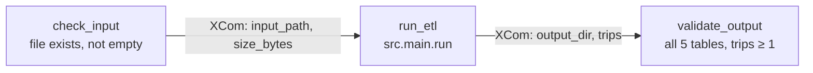

# Airflow orchestration (demo)

A small Airflow 3 DAG that runs this repository's pipeline. It reuses `src.main.run` unchanged and
adds the checks around it that a scheduler needs.



| Task | Does | Retries |
| --- | --- | --- |
| `check_input` | fails if the input file is missing or empty | 2 |
| `run_etl` | runs the Spark pipeline into `<output>/run_date=<logical date>/` and counts the trips | 2 |
| `validate_output` | fails unless all five output tables have `_SUCCESS` and `trips` has rows | 0 (a data problem, not a transient error) |

- **Idempotent:** each logical date writes to its own folder in overwrite mode, so a retry or a
  re-run for the same date replaces that date's results and leaves other dates alone.
- **Configuration** (environment variables): `NYC_TAXI_INPUT` (default
  `examples/sample_trips.csv`), `NYC_TAXI_OUTPUT_DIR` (default `output/airflow`).
- **Logic vs. wiring:** `orchestration/tasks.py` has no Airflow imports and is tested with plain
  pytest; `orchestration/dags/nyc_taxi_etl_dag.py` only connects the tasks.
- `schedule=None`: the DAG is triggered manually; the logical date names the output folder.

## Run it locally

Airflow 3.2.1 supports Python 3.10–3.13; this was tested with Python 3.12 and Java 17. Commands
run from the repository root.

```bash
python3.12 -m venv .venv-airflow
source .venv-airflow/bin/activate
pip install -r requirements-airflow.txt \
  --constraint https://raw.githubusercontent.com/apache/airflow/constraints-3.2.1/constraints-3.12.txt

export AIRFLOW_HOME=$PWD/.airflow AIRFLOW__CORE__DAGS_FOLDER=$PWD/orchestration/dags
export AIRFLOW__CORE__LOAD_EXAMPLES=False PYTHONPATH=$PWD PYSPARK_PYTHON=python

airflow db migrate                              # SQLite metadata database in .airflow/
airflow dags test nyc_taxi_etl 2019-01-01      # runs all three tasks in one process
ls output/airflow/run_date=2019-01-01/
```

`airflow dags test` runs the DAG without a scheduler or webserver. To see it in the UI, run
`airflow standalone` with the same environment and trigger `nyc_taxi_etl`.

## Tests

`tests/test_orchestration.py`: configuration from the environment, the per-date output folder, the
input checks, two runs into the same folder giving the same result, validation failing on missing
output, and — when Airflow is installed — that the DAG imports cleanly with the three tasks in
order and the retry settings above. CI runs these and `airflow dags test` on the sample data.

## Limitations

- Runs Spark in local mode inside the Airflow worker; on a real deployment the ETL task would
  submit to a cluster (e.g. `SparkSubmitOperator` or EMR) instead.
- No Docker Compose setup: the official Airflow image has no Java, so it would need a custom image;
  that has not been built or tested.
- Only tried with the local SQLite metadata database and `airflow dags test`, not with a scheduler
  and a production database.
